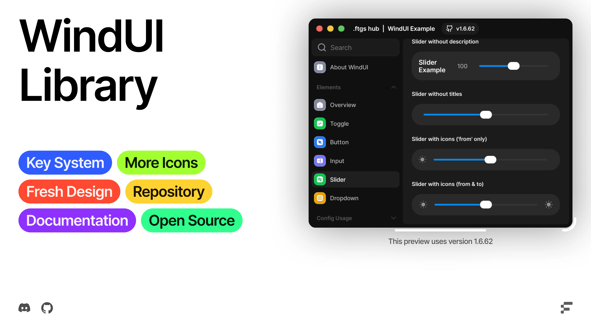

<!--<h1 align="center">WindUI</h1> -->

<!--
<picture>
    <source srcset="docs/banner-dark.webp" media="(prefers-color-scheme: dark)">
    <source srcset="docs/banner-light.webp" media="(prefers-color-scheme: light)">
    
</picture>-->


I might rewrite this project from scratch later.

> [!WARNING]
> This WindUI was not inspired by, and the name has nothing to do with UI Frameworks

> [!WARNING]
> WindUI is currently in Beta.
> This project is still under active development. Bugs, issues, and unstable features may occur. We’re constantly working on improvements, so please be patient and report any problems you encounter.

## Credits

#### Icons (https://github.com/Footagesus/Icons)

- [Lucide-Icons](https://github.com/lucide-icons/lucide)
- [Craft Icons](https://www.figma.com/community/file/1415718327120418204)
- [Geist Icons](https://vercel.com/geist/icons)
- [Solar Icons](https://icones.js.org/collection/solar)
- [SF Symbols](https://sf-symbols-one.vercel.app/)

### Links

- [Discord Server](https://discord.gg/ftgs-development-hub-1300692552005189632)
- [Documentation](https://footagesus.github.io/treehub-web/docs/windui)
- [Installation](https://footagesus.github.io/WindUI-Docs/docs/installation)
- [Example](/main_example.lua) (wip)
    ```luau
    loadstring(game:HttpGet('https://raw.githubusercontent.com/Footagesus/WindUI/refs/heads/main/main_example.lua'))()
    ```

## WindUI Modded: botões flutuantes

Esta versão adiciona botões flutuantes arrastáveis com suporte a mouse e toque, mantendo o estilo, os temas e as animações dos botões nativos da biblioteca.

```lua
local button = WindUI:AddFloatingButton({
    Icon = "zap",
    Position = UDim2.new(1, -42, 1, -42),
    Callback = function()
        print("Botão pressionado")
    end,
})
```

A instância retornada possui `SetPosition`, `SetVisible`, `SetDraggable`, `Edit` e `Destroy`. O alias `WindUI:CreateFloatingButton(config)` também está disponível. Consulte [docs/FLOATING_BUTTONS.md](docs/FLOATING_BUTTONS.md) para a API completa.

### OpenButton sem botão de arraste

Para esconder o ícone visual de arraste do botão que abre a janela, use `HideDragButton = true` na configuração do `OpenButton`. Nesse modo, todo o botão funciona como um botão flutuante: um clique ou toque abre a janela; pressionar e mover arrasta o próprio OpenButton sem abrir a janela ao soltar.

```lua
local window = WindUI:CreateWindow({
    Title = "Minha janela",
    OpenButton = {
        Enabled = true,
        HideDragButton = true,
    },
})
```
